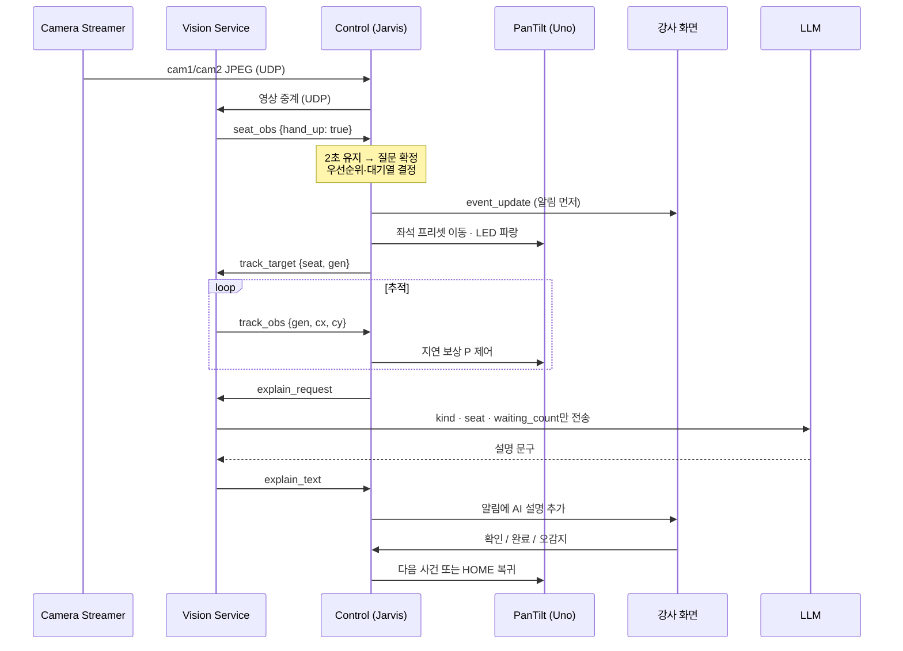

# 액티브 비전 AI 조교: 스마트 클래스룸

> **"손을 들었는데 아무도 못 봤다"** → 카메라가 먼저 **알아보고**, **찾아가고**, 강사에게 **설명**하는 강의실 AI 조교

SeSAC 피지컬 AI 과정 · 새싹 프로젝트 1 · AIoT 프로젝트 3팀 **SKYPOL**

강사 혼자서는 판서·코드 시연 중에 모든 학생을 볼 수 없습니다. 이 시스템은 강의실 고정 카메라로 **질문(손들기)·자리비움**을 감지하면 팬틸트 카메라가 그 좌석으로 돌아가 강사 화면에 확대 영상을 띄우고, AI 조교가 상황을 한두 문장으로 설명합니다. 학생 노트북은 각자의 **집중·자세**를 살펴 **본인에게만** 알립니다.

**방향성: 감시가 아니라 서포트.** 급한 순간은 강사에게, 개인 컨디션은 본인에게만 전달합니다.

---

## 목차

1. [해결하려는 문제](#해결하려는-문제)
2. [주요 기능](#주요-기능-system-requirements)
3. [시스템 구조](#시스템-구조)
4. [핵심 기술](#핵심-기술)
5. [결과](#결과)
6. [저장소 구조](#저장소-구조)
7. [설치](#설치)
8. [실행 방법](#실행-방법)
9. [설계 원칙과 개인정보](#설계-원칙과-개인정보)
10. [주요 결정과 한계](#주요-결정과-한계)
11. [팀](#팀)
12. [문서](#문서)

---

## 해결하려는 문제

- 판서·코드 시연 중인 강사는 모든 학생을 계속 볼 수 없습니다.
- 손 든 학생을 놓치거나, 누가 먼저 들었는지 알기 어렵습니다.
- 위급 상황은 발견이 늦을수록 위험합니다.
- 장시간 학습으로 졸음과 나쁜 자세가 반복되지만, 스스로 알아차리기 어렵습니다.

## 주요 기능 (System Requirements)

| SR | 기능 | 누구를 돕나 | 구현 상태 |
| --- | --- | --- | --- |
| SR_001 | 강의장 시설물 관리 (좌석·장비·팬틸트 각도 등록) | 강사 | ✅ |
| SR_002 | 쓰러짐 학생 지원 (즉시 → 15초 옆자리 → 30초 전체 알림) | 학생, 강사 | ⚠️ 알림·확인 흐름만 구현, 카메라 감지는 범위 제외 |
| SR_003 | 질문 학생 지원 (손든 순서 보장) | 학생, 강사 | ✅ |
| SR_004 | 자리비움 학생 확인 | 강사 | ✅ |
| SR_005 | 음성 도움 요청 지원 (선택) | 학생, 강사 | ➖ 미구현 |
| SR_006 | 학습 집중 지원 (졸음·하품·전방 주시, 본인 알림) | 학생 | ✅ |
| SR_007 | 바른 자세 유지 지원 (숙임·고개 기울임·어깨 비대칭, 본인 알림) | 학생 | ✅ |
| SR_008 | 수업 휴식 판단 지원 (반 평균만) | 강사 | ✅ |

추가로 AI 조교는 다음을 제공합니다.

- **상황 설명:** 사건마다 "4번 좌석 학생이 손을 들고 질문을 기다리고 있습니다. 대기 순서는 2번째입니다" 같은 문구
- **자연어 질의:** "오늘 질문 몇 번?", "장비 다 연결돼 있어?" → LLM이 조회 도구를 골라 답변 (조회만)
- **카메라 명령:** "1번 좌석 보여줘", "원위치"
- **수업 종료 리포트:** 숫자는 Control이 집계, 문장(요약·살펴볼 점)만 LLM이 작성

## 시스템 구조

**장비가 보고, 서버가 판단하고, 화면이 알리는 3계층 구조**입니다. 모든 연결은 중앙 컨트롤 서비스 **Jarvis** 한 곳으로 모이고, 노드끼리는 직접 통신하지 않습니다. 그래서 판단은 한 곳에서만 일어납니다.


| 연결 | 방식 | 내용 |
| --- | --- | --- |
| 노드 ↔ Control | **TCP 바이너리 프레임 v3** (포트 5000) | 이벤트·명령·관측. 26바이트 헤더(node·type·seat·seq·ts) + payload + CRC |
| 카메라 → Control → Vision·강사 화면 | **UDP** | JPEG 프레임 중계 (15fps, 가로 최대 640px) |
| Control → Arduino | **USB Serial** | 한 줄 ASCII 명령 (`S`, `T`, `H`, `L` …) |
| Vision → LLM | **HTTP(S)** | Gemini → Ollama 순 호출 |
| DB | SQLite (WAL) | **Control만** 읽고 씀 |

> 처음에는 메시지를 JSON으로 보냈지만, 데이터가 깨져도 알 수 없어서 CRC로 검증하는 바이너리 프레임 하나로 통일했습니다. 질문 메시지 하나가 **143바이트 → 50바이트**로 줄었습니다.

### 동작 흐름 (질문 예시)

기능별 시나리오는 8개지만 흐름은 하나입니다. **감지 → Jarvis가 판단 → 행동 → 알림.** 알림이 먼저 가고 AI 설명은 뒤에 붙습니다.



## 핵심 기술

### 1. 넓게 보고, 좁게 확인한다

고정 카메라는 **전체 감시**, 팬틸트는 **대상 학생 확인**을 맡습니다. 역할을 나눠 특정 학생을 추적하는 동안에도 전체 감지를 유지합니다.

**강의실 감지 (Vision Service)**
- 고정 카메라 1대 + **YOLO Pose + ByteTrack**으로 4좌석을 전체 프레임에서 분석
- 좌석 등록: 앉아 있는 학생의 어깨 중심을 클릭해 기준 위치·크기 저장 → 어깨 위치·크기와 추적 ID로 좌석 연결
- **손들기:** 손목과 어깨 위치로 판단 / **자리비움:** 등록 위치에 사람이 보이지 않는 상태 지속
- 관측 값은 `True` / `False` / `None`(관측 불가). 가림·애매한 상황은 보수적으로 UNKNOWN 처리

**능동 추적 (PanTiltService + Arduino)**
- **넓게 빠르게(좌석 프리셋, 개루프) → 좁게 정확하게(코 좌표 P 제어, 폐루프)**
- **영상 지연 보상:** 분석 결과가 도착했을 때 카메라는 이미 움직였을 수 있으므로, 현재 각도가 아니라 **촬영 순간의 각도**를 기준으로 목표 각도를 계산해 중복 보정(오버슈트)을 막음
- 화면 중심에서 멀수록 크게, 가까울수록 작게 보정하는 P 제어
- 8상태 FSM: `INIT · IDLE · MOVE_TO_SEAT · TRACKING · SEARCHING · HOLD_SEAT · RETURN_HOME · SAFE`
- cam2에 **사람 한 명 + 유효한 코 키포인트**일 때만 좌표 전송, 처리 지연 0.3초 초과 시 `LOST`

### 2. 사건 확정은 Control 한 곳에서

Vision은 좌석별 **관측값만** 보내고, Control의 `event_manager`가 얼마나 이어지는지 보고 사건을 확정합니다. 강사 화면은 표시와 확인·완료 입력만 받습니다.

| 사건 | 확정 기준 | 우선순위 | LED |
| --- | --- | --- | --- |
| 쓰러짐 | (카메라 감지 제외) | 1 | 🔴 빨강 |
| 질문 | 손들기 **2초** 유지 | 2 | 🔵 파랑 |
| 자리비움 | 부재 **10초** 유지, 60초 초과 시 재알림, 복귀 시 자동 해제 | 3 | 🟢 초록 |

- 일정 시간 지속될 때 확정해 순간 동작에 의한 오경보를 줄이고, 잠깐의 인식 끊김은 허용
- 상위 사건이 오면 **선점**(처리 중인 사건은 대기열로), 같은 순위는 도착 순서대로
- 대상이 바뀔 때마다 **`gen` 번호**를 올려, 이전 대상의 늦게 도착한 좌표를 버림

### 3. 학생 컨디션: MediaPipe로 측정, 학습 모델로 판단

학생 노트북 웹캠 1대로 얼굴 상태와 앉은 자세를 판정합니다. **MediaPipe는 측정일 뿐**이고, 임계값 규칙은 장소가 바뀌면 맞지 않아서 직접 수집한 데이터로 학습한 모델이 판단합니다.

| 영역 | 측정 | 판단 모델 | 판정 항목 |
| --- | --- | --- | --- |
| 얼굴 | Face Landmarker (프레임당 수치 56개) | 1D-CNN 시계열 ×3 (30프레임) + MobileNetV3-Small 이미지 ×2 | 졸음, 하품, 전방 주시 미흡 |
| 자세 | Pose Landmarker (바른 자세 대비 변화량) | 수치 MLP ×1 + MobileNetV3-Small 이미지 ×6 (배경 제거·실루엣) | 앞으로 숙임, 고개 기울임, 어깨 비대칭 |

- 바른 자세는 사람마다 다르므로 **처음 10초 등록 → 기준 대비 변화로 판정**
- 수치·이미지를 한 모델로 융합(D)하는 대신 **따로 학습한 결과를 가중 평균(E)** — 얼굴 검증에서 앞 보기 오경보 39% → 5%
- 시계열 모델로 깜빡임↔졸음, 말하기↔하품 구분 — 앞 보기 오경보 5% → 2.8%
- 판정 결과는 **본인 화면에만**, 서버로는 10초마다 참/거짓 8개(`condition_summary`)만 보내 강사 화면에 **반 평균**으로 표시

### 4. AI 상황 설명: 알림을 먼저, 설명은 따로

```
Gemini (클라우드, 평균 0.87초) → 실패 시 Ollama qwen2.5:3b (로컬 GPU, 오프라인 동작) → 실패 시 기본 문구 7종
```

- 알림은 AI 응답을 기다리지 않습니다 (비동기). 늦게 온 옛 설명은 `seq` 번호로 걸러 버립니다.
- LLM에는 **사건 종류·좌석·경과 시간·대기 수만** 보내고, 영상이나 학생 이름은 보내지 않습니다.
- 한자가 섞이거나 문장이 끝나지 않은 답은 버리고 다음 단계로 넘깁니다.
- Gemini가 한 번 실패하면 그 모델을 60초 동안 건너뜁니다.

## 결과

| 항목 | 결과 |
| --- | --- |
| 통합 시연 | 2×2 좌석, 카메라 2대, 노트북 5대로 질문·자리비움·우선순위 선점·학생 알림 4개 시나리오 연동 |
| 자세 판정 (처음 보는 테스트 4세션, 균형 정확도) | MediaPipe 규칙 **0.591 → 학습 모델 0.872** |
| 얼굴 판정 (처음 보는 장소, 균형 정확도) | 규칙 0.540 → 학습 모델 **0.787** |
| 얼굴 정상 구간 오경보 (10분당) | **48.5건 → 4.4건** |
| 메시지 크기 | JSON 143B → 바이너리 50B |
| AI 설명 응답 | Gemini 평균 0.87초 |

**시연 시나리오**

1. 손을 2초 들면 질문으로 확정 → 팬틸트가 회전 → 강사 화면에 확대 영상
2. 자리를 10초 비우면 확정 → 1분 넘게 안 오면 재알림 → 돌아오면 자동 해제
3. 자리비움 처리 중에 손을 들면 질문이 우선 → 팬틸트가 질문 좌석으로 전환
4. 졸음은 본인에게만 알림 → 강사에게는 반 평균과 AI 휴식 권장만 전달

## 저장소 구조

```
aiot_repo_3/
├─ common/                         모든 노드 공용: 프로토콜(바이너리 v3), NodeClient, 설정 로더
├─ config/common.yaml              control_host, control_port (모든 노드)
├─ gui/
│  ├─ instructor_console/          강사 화면 (PyQt6) — run_console.py
│  └─ student_client/              학생 화면·얼굴/자세 판정·학습 코드 — student_gui/, run_client.py
├─ service/
│  ├─ jarvis_control_service/      중앙 허브: 이벤트 판단, DB 기록, 영상 중계, 녹화, 팬틸트 제어 — run_hub.py
│  │  └─ hub/pantilt/              PanTiltService (FSM, P 제어, Uno 시리얼)
│  ├─ jarvis_vision_service/       영상 분석(YOLO Pose) + AI 조교(LLM) — run_assistant.py
│  └─ jarvis_DB/create.sql         DB 스키마 (테이블 8개)
├─ hw/
│  ├─ camera_controller/           Arduino Uno 펌웨어 camera_controller.ino
│  └─ camera_streamer/             UDP 영상 송출 — run_fixed_camera.py(cam1), run_pantilt_camera.py(cam2)
├─ technical_research/             기술 조사 자료
├─ requirements.txt / constraints.txt
└─ README.md
```

## 설치

```bash
python3 -m venv ~/venv/aiot_repo_3
source ~/venv/aiot_repo_3/bin/activate
pip install -r requirements.txt -c constraints.txt
```

- PyTorch는 CUDA 13(cu130) 빌드를 사용합니다. NVIDIA 드라이버가 CUDA 13 이상을 지원하는지 `nvidia-smi`로 확인하세요.
- Vision 서비스는 **Ultralytics**와 `*-pose.pt` 가중치가 추가로 필요합니다 (`requirements.txt`에 미포함).
- 학생 판정 모델(`models/`)과 MediaPipe 모델(`assets/`)은 git에 없습니다. [학생 화면 README](gui/student_client/README.md#2-git에-없는-파일-이-폴더-아래에-둔다)를 참고하세요.
- Gemini API 키는 `service/jarvis_vision_service/.env`에 둡니다 (`.env.example` 참고, **git에 올리지 않음**).
- 모든 노드의 Control 주소는 `config/common.yaml`의 `control_host`, `control_port`(5000)로 맞춥니다.

## 실행 방법

아래는 **강사 컴퓨터에서 Control·Vision·강사 화면을 함께 실행**하는 배치 기준입니다. 각 터미널에서 저장소 루트(`aiot_repo_3/`)에 있다고 가정하며, `<강사컴퓨터_IP>`·모델 경로·장치 번호는 실제 값으로 바꿉니다.

```bash
# 0. (최초 1회) 고정카메라 좌석 등록 → 생성된 fixed_seats.local.json을 강사 컴퓨터로 복사
python3 service/jarvis_vision_service/run_fixed_vision.py --source 0 --model /경로/yolo11s-pose.pt --device 0 --calibrate

# 1. Control 서버 (Arduino 연결, 없으면 --pantilt-sim)
python3 service/jarvis_control_service/run_hub.py --host 0.0.0.0 --pantilt-port /dev/ttyACM0

# 2. 강사 화면
python3 gui/instructor_console/run_console.py --host 127.0.0.1

# 3. 카메라 송출 (카메라가 연결된 PC)
python3 hw/camera_streamer/run_fixed_camera.py   --device 0 --target <강사컴퓨터_IP>
python3 hw/camera_streamer/run_pantilt_camera.py --device 2 --target <강사컴퓨터_IP>

# 4. Vision + AI 조교
python3 service/jarvis_vision_service/run_assistant.py --server 127.0.0.1 \
  --model /경로/yolo11s-pose.pt --device 0 --imgsz 640 \
  --seats service/jarvis_vision_service/config/fixed_seats.local.json

# 5. 학생 화면 (학생 노트북마다, 좌석 1~4)
cd gui/student_client && python -m student_gui.app --seat 1
```

- Arduino에는 `hw/camera_controller/camera_controller.ino`를 업로드하고, **업로드 후 시리얼 모니터는 닫습니다** (Control이 포트를 직접 엽니다).
- 관제 노트북 방화벽에서 TCP 5000, UDP 6001/6002를 허용하세요.
- 장비 없이 통신만 시험: `cd service/jarvis_control_service && python3 -m tools.fake_node --server 127.0.0.1`

자세한 실행·문제 해결은 모듈별 문서를 참고하세요.

| 모듈 | 문서 |
| --- | --- |
| Control 서버 (설계 기준·메시지·테스트) | [service/jarvis_control_service/CLAUDE.md](service/jarvis_control_service/CLAUDE.md) |
| Vision + AI 조교 | [service/jarvis_vision_service/README.md](service/jarvis_vision_service/README.md) |
| 고정카메라 상세 | [service/jarvis_vision_service/docs/README_FIXED_CAMERA.md](service/jarvis_vision_service/docs/README_FIXED_CAMERA.md) |
| 팬틸트 모듈 | [service/jarvis_control_service/hub/pantilt/README.md](service/jarvis_control_service/hub/pantilt/README.md) |
| Arduino 펌웨어·배선 | [hw/camera_controller/README.md](hw/camera_controller/README.md) |
| 학생 화면·판정 모델 | [gui/student_client/README.md](gui/student_client/README.md) |
| 학생 모델 실험 기록 | [gui/student_client/docs/experiments.md](gui/student_client/docs/experiments.md) |

## 설계 원칙과 개인정보

**필요한 것만 남기고, 필요한 사람에게만 보여 줍니다.**

- **판단은 강사가:** 시스템은 알리고 보여 주며, 확인·완료·오감지 처리는 사람이 합니다.
- **저장하는 것:** 도움 요청과 처리 기록, 10초마다의 반 평균, 이벤트가 생겼을 때의 팬틸트 녹화(7일 보관)뿐입니다.
- **저장하지 않는 것:** 고정 카메라와 학생 웹캠 영상은 실시간으로 보기만 합니다.
- **개인 컨디션은 본인에게만:** 학생 개인의 집중도·자세는 본인 화면에만 보이고, 강사에게는 반 평균만 갑니다.
- **외부 AI에는 이름·영상을 보내지 않습니다.** 메시지에는 좌석 번호만 사용합니다.
- **AI는 실시간 루프 밖:** 알림은 AI 응답을 기다리지 않습니다.
- 학생 판정 학습 데이터(`data/`, `eval/`)에는 얼굴 이미지가 있어 **공개 저장소에 올리지 않습니다.**

## 주요 결정과 한계

**주요 결정**

1. 고정 카메라는 **영상만 보내고**, 판정은 Vision 한 곳에서 합니다.
2. 사건 확정은 Vision이 아니라 **Control**이 합니다.
3. 팬틸트 판단 로직을 **Control 안으로** 옮겨 TCP 통신을 함수 호출 + Serial 직결로 단순화했습니다.
4. 강사 화면은 **세로 탭 + 이벤트 로그 중심** 구조로 바꿨습니다.
5. **쓰러짐 감지는 이번 범위에서 제외**했습니다. 바닥 가림과 좌석 식별 문제로 검증이 어려워 손들기·자리비움에 집중했습니다. (알림·확인 흐름과 프로토콜은 구현되어 있습니다.)

**한계와 다음 단계**

- 앞사람에 가린 뒷자리의 인식이 불안정 → 카메라 배치·좌석 간격 조정 필요
- 팬틸트 추적이 간헐적으로 실패
- 학생 판정은 정면 웹캠 1대·한 사람의 연기 데이터 기반 → 측면·뎁스 카메라, 여러 사람·실제 수업 데이터 필요
- 다음 단계: 녹화·검색 고도화, 엣지 LLM, 좌석 확장, 음성 도움 요청(SR_005)

## 팀

여섯 명의 이름 첫 글자가 팀 이름 **SKYPOL**입니다.

| 이름 | 역할 |
| --- | --- |
| 이종서 | 팀장 · 강의실 감지 설계 · 공통 운영 총괄 (TCP 서버·SQLite, 개인정보 점검) |
| 박병준 | 능동 추적 — 팬틸트 조립, Arduino 펌웨어, 좌석별 각도, PanTiltService |
| 양현우 | Vision Service — YOLO Pose·트래커, 좌석 관측, 추적 좌표 · 장비 상태·시각 동기화 |
| 성재민 | 학생 모니터링 — MediaPipe·학습 모델, 집중·자세 판정, 학생 화면 |
| 강지우 | Control 서버·통신 구조 · 강사 화면 · AI 조교 |
| 오원준 | 공통 운영 지원 — 테스트 계획·성능 측정, 네트워크, 통합 시연 |

**일정:** Sprint 1 (10/13~10/16) 요구사항·설계·기술조사 → Sprint 2 (10/19~10/23) 구현·통합 테스트 → 10/26 회고·발표

## 문서

- Confluence: [새싹 프로젝트 1 Home](https://skypol-sesac.atlassian.net/wiki/spaces/1/overview)
  - [System Requirements](https://skypol-sesac.atlassian.net/wiki/spaces/1/pages/950304/System+Requirements) · [System Architecture](https://skypol-sesac.atlassian.net/wiki/spaces/1/pages/360667/System+Architecture) · [System Scenario](https://skypol-sesac.atlassian.net/wiki/spaces/1/pages/851980/System+Scenario) · [Interface Specification](https://skypol-sesac.atlassian.net/wiki/spaces/1/pages/458805/Interface+Specification) · [Data Structure](https://skypol-sesac.atlassian.net/wiki/spaces/1/pages/7569411/Data+Structure)
  - [Vision Service 기능별 문서](https://skypol-sesac.atlassian.net/wiki/spaces/1/pages/12451859/Vision+Service) · [Camera Controller](https://skypol-sesac.atlassian.net/wiki/spaces/1/pages/6094856/Camera+Controller) · [학생 모니터링 기술 조사](https://skypol-sesac.atlassian.net/wiki/spaces/1/pages/7405597) · [LLM 기술조사](https://skypol-sesac.atlassian.net/wiki/spaces/1/pages/12451844/LLM)
- 발표 자료: [SKYPOL_발표자료_최종.pptx](https://drive.google.com/file/d/1aKtbfa-FhK1SKimgVMr-7FiXUVs39t6U/view)
